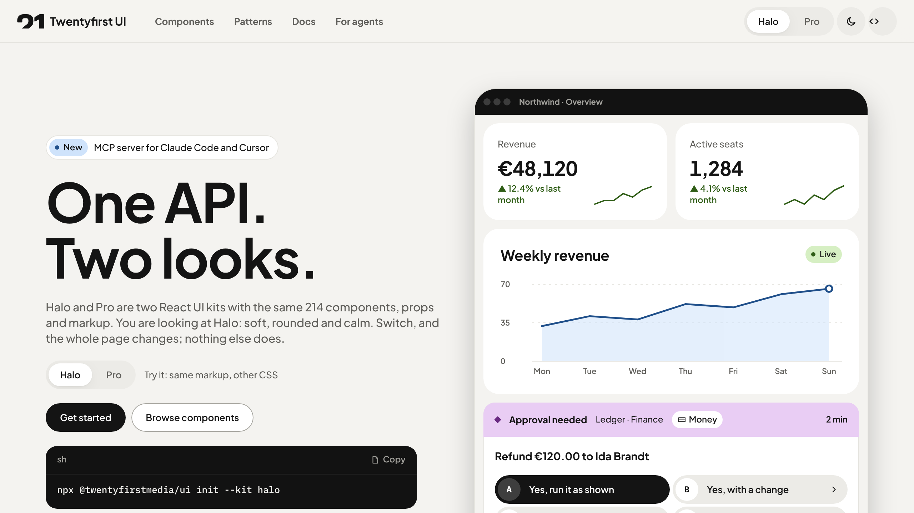
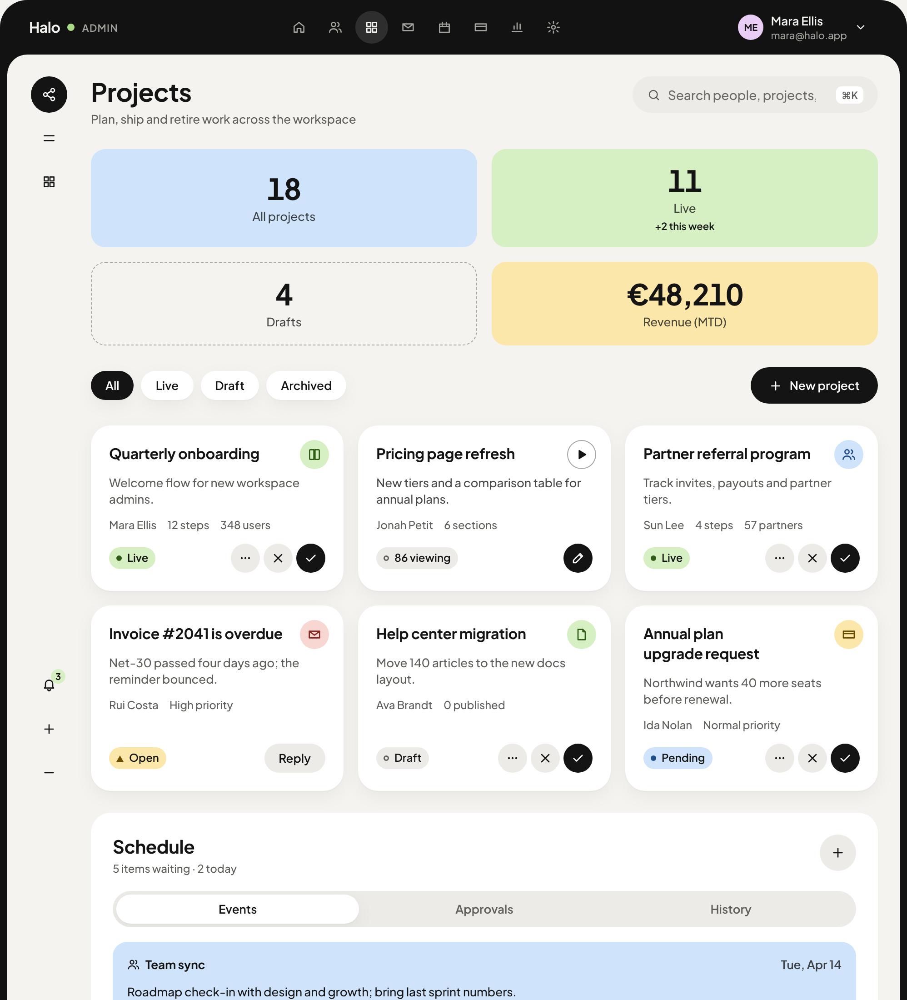
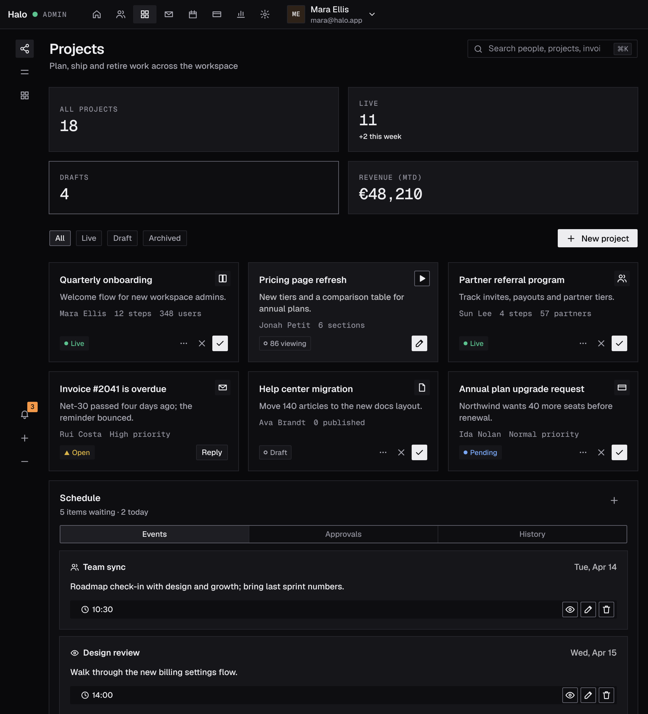
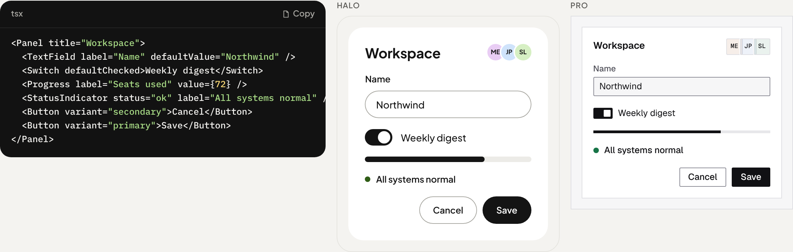
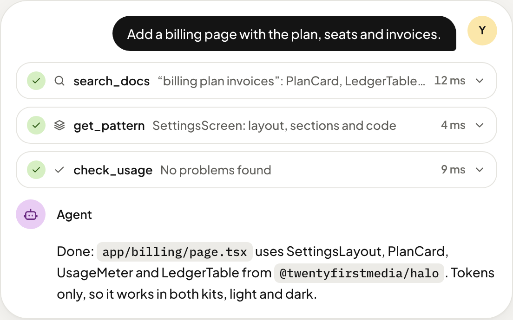

<p align="center">
  <a href="https://ui.twentyfirst.media">
    <picture>
      <source media="(prefers-color-scheme: dark)" srcset=".github/assets/logo-white.svg" />
      
    </picture>
  </a>
</p>

<h1 align="center">Twentyfirst UI</h1>

<p align="center">
  <strong>Two React UI kits. One API.</strong><br />
  Halo is soft and calm, Pro is sharp and dense. Same components, same props, same markup:<br />
  pick a look, or switch at runtime.
</p>

<p align="center">
  <a href="https://www.npmjs.com/package/@twentyfirstmedia/halo"></a>
  <a href="https://github.com/twentyfirstmedia/ui/actions/workflows/ci.yml"></a>
  <a href="LICENSE"></a>
  
  
  <a href="https://ui.twentyfirst.media/halo/ai/"></a>
</p>

<p align="center">
  <a href="https://ui.twentyfirst.media"><strong>Website</strong></a> ·
  <a href="https://ui.twentyfirst.media/halo/">Halo docs</a> ·
  <a href="https://ui.twentyfirst.media/pro/">Pro docs</a> ·
  <a href="https://ui.twentyfirst.media/halo/components/">Components</a> ·
  <a href="https://ui.twentyfirst.media/halo/patterns/">Patterns</a> ·
  <a href="https://ui.twentyfirst.media/llms.txt">llms.txt</a>
</p>

<br />

<a href="https://ui.twentyfirst.media">
  <picture>
    <source media="(prefers-color-scheme: dark)" srcset=".github/assets/hero-pro.png" />
    
  </picture>
</a>

## Why Twentyfirst UI

- **One API, two looks.** Every component, prop, class and token exists in both kits. Load both and switch with `data-kit`: markup and state stay, only the CSS changes. A parity test fails the build if the kits drift apart.
- **214 components, 26 complete screens.** From buttons and data tables to chat, tool calls, agent status and human-in-the-loop approvals, plus commerce, admin and real-estate building blocks.
- **Finished from the first render.** Empty, loading, error and approval states come with the components.
- **Mobile first.** Works from 320px up: shells collapse, tables scroll, dialogs become sheets, inputs never zoom.
- **Accessible.** Keyboard paths, focus rings and ARIA on every component; axe (WCAG 2.1 AA) runs on every example in both kits, light and dark.
- **Tokens only.** No colour literals in component CSS. One token file per kit feeds CSS variables and a Tailwind v4 preset.
- **Private by default.** Self-hosted fonts, no telemetry, no network requests from components. Tree-shakeable: a Button is about 3 KB.
- **Built for coding agents.** An MCP server, `llms.txt` and a Markdown version of every docs page, so Claude Code, Cursor and friends use the real components instead of guessing.

## Two looks, one API

<table>
  <tr>
    <th width="50%">Halo: soft, rounded, light-first</th>
    <th width="50%">Pro: sharp, dense, dark-first</th>
  </tr>
  <tr>
    <td></td>
    <td></td>
  </tr>
</table>

The same JSX renders either way:

<picture>
  <source media="(prefers-color-scheme: dark)" srcset=".github/assets/parity-dark.png" />
  
</picture>

## Quick start

```sh
npx @twentyfirstmedia/ui init --kit halo   # or --kit pro
```

`init` installs the kit, imports its styles (and the Tailwind preset if you use Tailwind), creates a `UIProvider` root and wires up the Next.js layout. Or set it up by hand:

```sh
npm install @twentyfirstmedia/halo
```

```tsx
import "@twentyfirstmedia/halo/styles.css";
import { Button, Panel, TextField, UIProvider } from "@twentyfirstmedia/halo";

export function App() {
  return (
    <UIProvider theme="system">
      <Panel title="Workspace">
        <TextField label="Name" defaultValue="Northwind" />
        <Button variant="primary">Save</Button>
      </Panel>
    </UIProvider>
  );
}
```

**Both kits in one app:** import `@twentyfirstmedia/ui-core/themes.css` instead and switch with `<UIProvider kit="pro">` or `data-kit="pro"` on `<html>`.

**Tailwind v4:** `@import "@twentyfirstmedia/halo/tailwind.css";` after `@import "tailwindcss";` maps every token to utilities (`bg-surface`, `text-ink`, `rounded-lg`, `shadow-card`).

## Use it with AI agents

<picture>
  <source media="(prefers-color-scheme: dark)" srcset=".github/assets/agents-dark.png" />
  
</picture>

The CLI ships an MCP server with the docs of the version you installed. It runs offline, needs no account and has no runtime dependencies.

```sh
npx @twentyfirstmedia/ui mcp init
```

This registers it for **Claude Code** (`.mcp.json`), **Cursor** (`.cursor/mcp.json`) and **VS Code** (`.vscode/mcp.json`) and adds the kit's rules to `AGENTS.md`. To add it by hand:

```sh
claude mcp add twentyfirst-ui -- npx -y @twentyfirstmedia/ui mcp --kit halo
```

Tools: `search_docs`, `list_components`, `get_component`, `get_pattern`, `get_guide`, `get_tokens`, `list_icons` and `check_usage`. `check_usage` reviews code for unknown components, props or icons, missing required props and colour literals.

For any other LLM: [`/llms.txt`](https://ui.twentyfirst.media/llms.txt), [`/llms-full.txt`](https://ui.twentyfirst.media/llms-full.txt), and every page as Markdown: append `.md` to its path.

<br clear="right" />

## What's inside

| Group | Examples |
| --- | --- |
| **Foundations** | Button, IconButton, Badge, Avatar, Card, Panel, Tooltip, Accordion, Separator, Toggle |
| **Navigation** | Tabs, Menubar, NavigationMenu, Sidebar, TopBar, SubNav, CommandPalette |
| **Forms** | TextField, SelectMenu, Combobox, DatePicker, RangeSlider, FileDrop, Form validation |
| **Data** | DataTable, Table, KeyValue, TreeView, KanbanColumn, LogView, LedgerTable |
| **Charts** | LineChart, AreaChart, BarChart, StackedBarChart, Funnel, Gauge, Heatmap |
| **Overlays** | Modal, Drawer (sheet on any side), Popover, HoverCard, Menu, Toaster, ConfirmDialog |
| **AI** | ChatMessage, Composer, ToolCall, Reasoning, AgentCard, ApprovalCard, RunTrace, VoiceMode |
| **Commerce** | ProductCard, VariantPicker, OrderSummary, PlanCard, CouponCard |
| **Admin** | SettingsLayout, TwoFactorSetup, WebhookEndpoint, ExportDialog, ServiceMonitor |
| **Real estate and media** | ListingCard, MapView, ValuationCard, Gallery, Carousel |

Plus [26 complete screens](https://ui.twentyfirst.media/halo/patterns/): dashboard, AI chat, agent builder, storefront, billing, inbox, calendar, settings and more. Each one is built only from kit parts, with its full code.

## Packages

| Package | What it is |
| --- | --- |
| [`@twentyfirstmedia/halo`](https://www.npmjs.com/package/@twentyfirstmedia/halo) | Halo: every component plus Halo's `styles.css`, tokens, Tailwind preset and fonts |
| [`@twentyfirstmedia/pro`](https://www.npmjs.com/package/@twentyfirstmedia/pro) | Pro: every component plus Pro's `styles.css`, tokens, Tailwind preset and fonts |
| [`@twentyfirstmedia/ui-core`](https://www.npmjs.com/package/@twentyfirstmedia/ui-core) | The shared components, hooks, icons and `Intl` formatters; `themes.css` with both kits |
| [`@twentyfirstmedia/ui`](https://www.npmjs.com/package/@twentyfirstmedia/ui) | CLI (`init`, `add`, `list`, `diff`) and the MCP server (`mcp`, `mcp init`) |
| [`@twentyfirstmedia/elements`](https://www.npmjs.com/package/@twentyfirstmedia/elements) | Every component as a custom element (`<tf-button>`, `<tf-data-table>` …) for plain HTML, Vue, Svelte, Angular and Astro; React bundled |

All five are versioned together. React 18.3 or 19; ESM only; no runtime dependencies besides React. No React in your app? [Plain HTML and frameworks](https://ui.twentyfirst.media/halo/html/) shows the custom elements.

## Development

```sh
pnpm install
pnpm dev          # docs site on localhost with live reload
pnpm check        # format, lint, typecheck, unit tests
pnpm test:e2e     # Playwright: axe, screenshots, mobile, control sizes, SEO; both kits, light and dark
pnpm tokens       # regenerate token CSS and the Tailwind preset from tokens.json
pnpm changeset    # describe your change for the next release
```

The repository is a pnpm and Turborepo monorepo: `packages/core` (components), `packages/halo` and `packages/pro` (tokens and CSS), `packages/cli` (CLI and MCP server), `packages/elements` (custom elements), `apps/docs` (the website), `examples/` (every live example) and `e2e/`. See [CONTRIBUTING.md](CONTRIBUTING.md) for the rules that keep the two kits identical.

## Contributing

Issues and pull requests are welcome. Please read [CONTRIBUTING.md](CONTRIBUTING.md) and our [Code of Conduct](CODE_OF_CONDUCT.md). To report a security issue, see [SECURITY.md](SECURITY.md).

## License

[MIT](LICENSE) © Twentyfirst Media. The bundled fonts (Plus Jakarta Sans, IBM Plex Mono, Geist, Geist Mono) are licensed under the SIL Open Font License 1.1.

<p align="center">
  <br />
  <a href="https://twentyfirst.media">
    <picture>
      <source media="(prefers-color-scheme: dark)" srcset=".github/assets/logo-white.svg" />
      
    </picture>
  </a>
</p>
