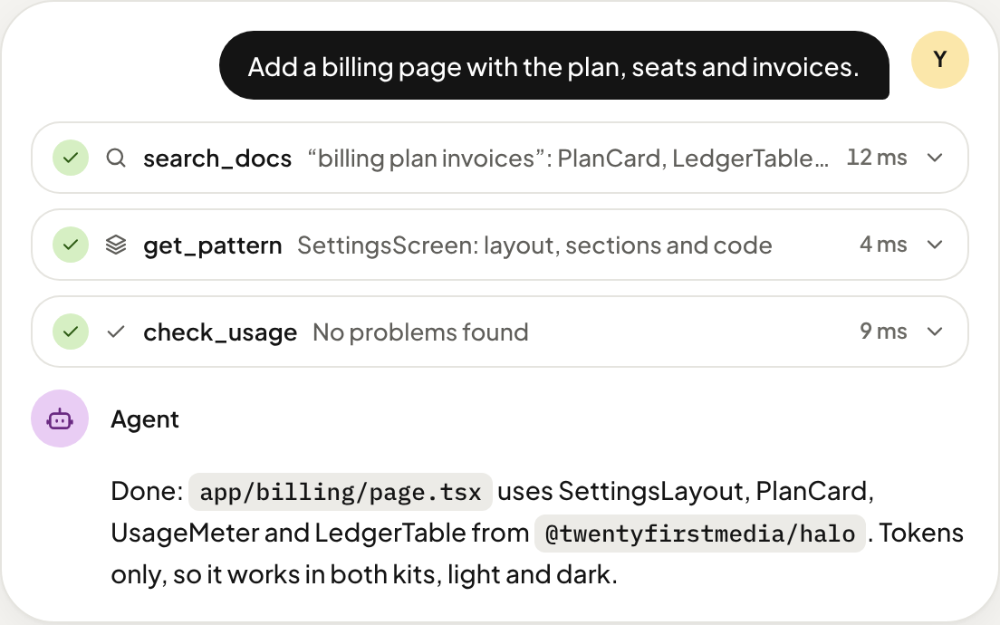

# @twentyfirstmedia/ui

The CLI and MCP server of the [Twentyfirst UI](https://ui.twentyfirst.media) kits.

[Website](https://ui.twentyfirst.media) · [Halo docs](https://ui.twentyfirst.media/halo/) · [Pro docs](https://ui.twentyfirst.media/pro/) · [GitHub](https://github.com/twentyfirstmedia/ui) · [llms.txt](https://ui.twentyfirst.media/llms.txt)

## Set up an app

```sh
npx @twentyfirstmedia/ui init --kit halo      # or pro; --both loads both kits
npx @twentyfirstmedia/ui add DataTable        # copy a component into components/ui to own it
npx @twentyfirstmedia/ui list                 # every component, copied ones marked
npx @twentyfirstmedia/ui diff DataTable       # compare your copy with the package
```

`init` installs the kit, imports its styles (and the Tailwind v4 preset when the app uses Tailwind), creates `components/ui-root.tsx` with the `UIProvider` and wires up the Next.js layout. Running it again changes nothing.

## MCP server for coding agents



```sh
npx @twentyfirstmedia/ui mcp init                         # Claude Code, Cursor, VS Code + AGENTS.md rules
claude mcp add twentyfirst-ui -- npx -y @twentyfirstmedia/ui mcp --kit halo
```

A stdio MCP server with the bundled docs of this version: offline, no account, no runtime dependencies.

| Tool | Returns |
| --- | --- |
| `search_docs` | Matching components, patterns, guides, tokens and icons |
| `list_components` | Every component page by group |
| `get_component` | Import, description, example code and props |
| `get_pattern` | A complete screen with its code |
| `get_guide` | Installation, CLI, theming, AI agents, status and approvals |
| `get_tokens` | Token names with Halo and Pro values |
| `list_icons` | Every valid icon name |
| `check_usage` | Unknown components, props or icons, missing required props, colour literals |

Every page is also a resource (`twentyfirst-ui://components/DataTable`), and the prompts `build_screen` and `review_ui` start the two most common jobs. Docs: [AI agents and MCP](https://ui.twentyfirst.media/halo/ai/).

## License

[MIT](https://github.com/twentyfirstmedia/ui/blob/main/LICENSE) © Twentyfirst Media. Fonts under the SIL Open Font License 1.1.
