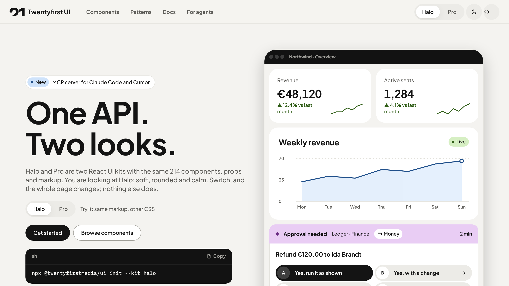

# @twentyfirstmedia/halo

**Halo**: soft, rounded and light-first: big white cards on a warm canvas, five pastel tints that carry meaning and ink as the only accent. One of the two [Twentyfirst UI](https://ui.twentyfirst.media) kits: 236 accessible React components and 37 complete screens with exactly the same API as [Pro](https://www.npmjs.com/package/@twentyfirstmedia/pro).

[Website](https://ui.twentyfirst.media) · [Halo docs](https://ui.twentyfirst.media/halo/) · [Pro docs](https://ui.twentyfirst.media/pro/) · [GitHub](https://github.com/twentyfirstmedia/ui) · [llms.txt](https://ui.twentyfirst.media/llms.txt)



## Install

```sh
npx @twentyfirstmedia/ui init --kit halo   # sets up styles, provider and layout
# or
npm install @twentyfirstmedia/halo
```

```tsx
import "@twentyfirstmedia/halo/styles.css";
import { Button, UIProvider } from "@twentyfirstmedia/halo";

export function App() {
  return (
    <UIProvider theme="system">
      <Button variant="primary">Save</Button>
    </UIProvider>
  );
}
```

## What you get

- Every component of `@twentyfirstmedia/ui-core`, re-exported.
- `styles.css`: self-hosted fonts, tokens for light and dark, all component styles.
- `tailwind.css`: a Tailwind v4 preset that maps every token (`bg-surface`, `text-ink`, `shadow-card`).
- `tokens.css`, `tokens.json`, `fonts.css` and `scoped.css` (scoped under `[data-kit="halo"]`) for custom setups.

Need both looks in one app? Import `@twentyfirstmedia/ui-core/themes.css` and switch with `<UIProvider kit="pro">`.

## Coding agents

```sh
npx @twentyfirstmedia/ui mcp init
```

Gives Claude Code, Cursor and VS Code an MCP server with every component, its props and examples. See [AI agents and MCP](https://ui.twentyfirst.media/halo/ai/).

## License

[MIT](https://github.com/twentyfirstmedia/ui/blob/main/LICENSE) © Twentyfirst Media. Fonts under the SIL Open Font License 1.1.
